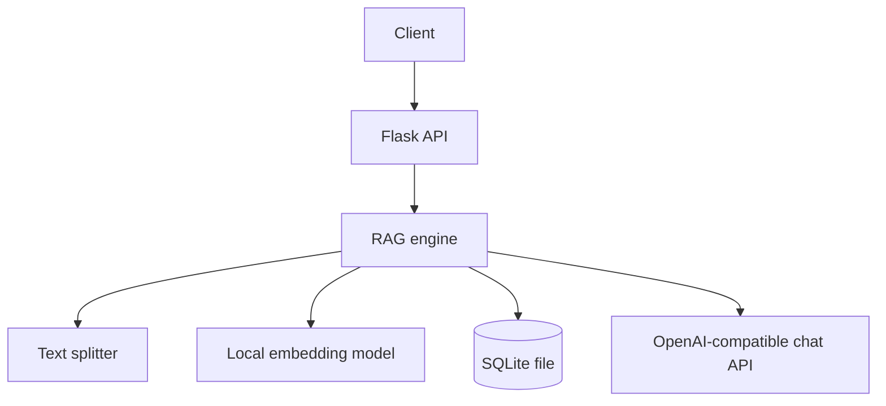

# Enterprise RAG Assistant

A production-style Retrieval-Augmented Generation service. It indexes enterprise documents in a local SQLite file, retrieves the closest passages by cosine similarity, and answers questions from those passages.

The API is a small Flask application. Embeddings are computed locally with a sentence-transformers model, so document text is not sent to a third party just to be embedded. Answer wording is optional: with an OpenAI-compatible API key the service calls a chat model, and without one it returns the retrieved passages directly.

## Architecture



1. `POST /upload` accepts UTF-8 text, Markdown, a digital PDF, or a JSON `text` field.
2. The engine splits the text into overlapping chunks with LangChain's recursive character splitter.
3. `sentence-transformers` encodes each chunk on CPU by default. The model is `all-MiniLM-L6-v2`, which produces 384-dimensional vectors.
4. SQLite stores the document, the chunk text, and the vector in `rag.sqlite`. Search ranks those vectors in the application process.
5. `POST /query` embeds the question, loads the nearest chunks above `MIN_SIMILARITY`, and either calls the chat model with those passages or quotes them.

The SQLite file and the embedding weights are created on the first request that needs them. `GET /health` opens the database file and does not load the model.

## Tech stack

| Piece | Choice |
| --- | --- |
| API | Flask 3 |
| Database | SQLite, included with Python. Vectors are stored in the file and ranked in process. |
| Embeddings | PyTorch, Hugging Face Transformers, and sentence-transformers |
| Chunking and prompts | LangChain Core and LangChain Text Splitters |
| PDF text | pypdf |
| Configuration | Environment variables via python-dotenv |
| Process server | Gunicorn on Linux. The built-in Flask server is for local development, including Windows. |

LangChain Core is used for the grounded prompt. The service does not depend on the full LangChain distribution.

## Project layout

```text
app.py            Flask application and HTTP validation
rag_engine.py     Chunking, embeddings, SQLite storage, and generation
requirements.txt  Python dependencies
.env.example      Configuration template
```

## Prerequisites

- Python 3.11 or newer
- Network access the first time the embedding model is downloaded
- An OpenAI-compatible API key only if you want generated prose

The database is a SQLite file created automatically. No database server or password is required.

## Setup

From the repository root, with the virtual environment activated:

```powershell
python -m venv venv
.\venv\Scripts\Activate.ps1
python -m pip install --upgrade pip
python -m pip install torch --index-url https://download.pytorch.org/whl/cpu
python -m pip install -r requirements.txt
copy .env.example .env
```

On macOS or Linux, activate with `source venv/bin/activate` and copy the template with `cp .env.example .env`. Install the default PyTorch wheel, or the CPU wheel above, before the rest of the requirements so pip does not pull a large CUDA build.

`.env` is optional for a local run. `SQLITE_PATH` defaults to `rag.sqlite` beside the application. Start the API:

```powershell
python app.py
```

The development server listens on `http://127.0.0.1:5000`. On Linux, a production process can use Gunicorn. Keep the worker count low, because each worker loads its own copy of the embedding model:

```bash
gunicorn --bind 0.0.0.0:8000 --workers 1 --timeout 120 "app:app"
```

The first upload or query downloads `all-MiniLM-L6-v2` from Hugging Face into the local model cache. Later requests reuse it.

## API

When `APP_API_KEY` is set, send it as `X-API-Key` or `Authorization: Bearer <key>` on every route except `GET /health` and `GET /`.

### Health

`GET /health`

```json
{
  "status": "ok",
  "database": true,
  "embedding_model": "sentence-transformers/all-MiniLM-L6-v2",
  "llm_configured": false
}
```

`status` is `degraded` and the HTTP status is 503 when the SQLite file cannot be opened.

### Upload a file

`POST /upload` with multipart field `file`. Extensions: `.txt`, `.md`, `.markdown`, `.pdf`.

```powershell
curl.exe -F "file=@.\handbook.txt" http://127.0.0.1:5000/upload
```

### Upload raw text

`POST /upload` with `Content-Type: application/json`.

```json
{
  "filename": "leave-policy.md",
  "text": "Full-time staff accrue 15 days of paid leave each calendar year."
}
```

A successful upload returns `201`:

```json
{
  "document_id": "3f1c1c2e-6b4a-4f0e-9d1a-0c2b6a9e8f11",
  "filename": "leave-policy.md",
  "content_type": "text/plain",
  "chunk_count": 1
}
```

Scanned PDFs are rejected. This service extracts embedded PDF text and does not run OCR.

### Ask a question

`POST /query`

```powershell
curl.exe -H "Content-Type: application/json" -d '{"question":"How many leave days do full-time staff accrue?"}' http://127.0.0.1:5000/query
```

```json
{
  "answer": "...",
  "mode": "extractive",
  "sources": [
    {
      "document_id": "3f1c1c2e-6b4a-4f0e-9d1a-0c2b6a9e8f11",
      "filename": "leave-policy.md",
      "chunk_index": 0,
      "score": 0.71,
      "excerpt": "Full-time staff accrue 15 days of paid leave each calendar year."
    }
  ]
}
```

`mode` is `generated` when a language-model key is configured, `extractive` when the service quotes passages directly, and `none` when nothing scores at or above `MIN_SIMILARITY`. Optional `top_k` is an integer from 1 to 20.

Source excerpts are shortened for the response. Generation still sees the full chunk text, up to a 12,000-character context budget.

### List and delete

`GET /documents?limit=50` returns the newest documents, up to 200.

`DELETE /documents/<document_id>` removes the document and its chunks.

### Errors

Failures use one JSON shape:

```json
{"error": {"code": "invalid_document", "message": "Text files must be UTF-8."}}
```

Common codes are `bad_request`, `unauthorized`, `unsupported_media`, `payload_too_large`, `invalid_document`, `config_error`, `database_unavailable`, `database_error`, `model_unavailable`, `llm_error`, and `llm_auth_error`. Database details stay in the server log.

## Configuration

| Variable | Default | Purpose |
| --- | --- | --- |
| `SQLITE_PATH` | `rag.sqlite` | SQLite file. Relative paths are resolved next to the application. |
| `APP_API_KEY` | empty | Shared bearer token for document and query routes. |
| `EMBEDDING_MODEL` | `sentence-transformers/all-MiniLM-L6-v2` | Local Hugging Face embedding model. |
| `EMBEDDING_DIM` | `384` | Must match the model. Changing it requires a new SQLite file. |
| `EMBEDDING_DEVICE` | `cpu` | `cpu`, `cuda`, or `mps`. |
| `CHUNK_SIZE` | `800` | Maximum characters per chunk. |
| `CHUNK_OVERLAP` | `120` | Overlap between chunks. Must be smaller than `CHUNK_SIZE`. |
| `TOP_K` | `4` | Passages retrieved per question. |
| `MIN_SIMILARITY` | `0.2` | Lowest cosine similarity kept. Set `0` to keep every retrieved passage. |
| `MAX_CHUNKS` | `2000` | Reject a single upload above this many chunks. |
| `MAX_UPLOAD_BYTES` | `10485760` | Request body limit, 10 MB. |
| `LLM_API_BASE` | `https://api.openai.com/v1` | OpenAI-compatible origin. |
| `LLM_API_KEY` | empty | Chat API key. `OPENAI_API_KEY` is an alias. |
| `LLM_MODEL` | `gpt-4o-mini` | Chat model name. |
| `HOST` / `PORT` | `127.0.0.1` / `5000` | Development server bind address. |
| `LOG_LEVEL` | `INFO` | Standard library log level. |

## Security notes

- Set `APP_API_KEY` anywhere this process is reachable beyond your own machine. The key is one shared secret, not per-user authorization.
- Put the service on a private network. Uploaded text is stored in the SQLite file in full.
- SQL uses bound parameters. Upload names pass through Werkzeug's secure filename helper, and the body size is capped.
- The chat request includes the question and the retrieved passages. It does not include the rest of the corpus.
- Keep `.env` out of git. The repository ignore file already excludes it.

## Operational limits

- Each process holds one embedding model and serializes encode calls with a lock.
- Similarity search reads stored vectors and ranks them in memory. That is appropriate for a local document set, and it does not require a separate database server.
- The schema migration is idempotent. A file recorded with a different `EMBEDDING_DIM` is rejected until that file is deleted.
- Gunicorn workers do not share the model. One worker is the practical starting point on a CPU host. SQLite writes are serialized with a process lock.
