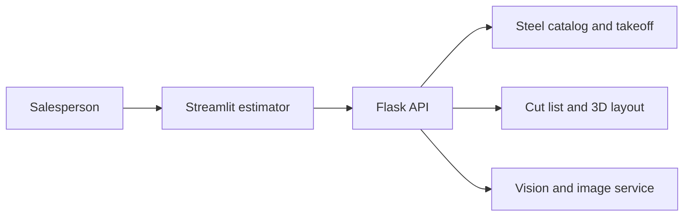

# Safeguard 4U Estimator & Structural Assistant

A sales and estimating workspace for a custom steel shop. A salesperson enters a takeoff, and the app returns a price **range**, a material recommendation, and a shop drawing the client can review before fabrication.

This repository is a product overview for hiring managers. The implementation, prompts, and pricing model live in a private repository.

## What a user can do

- Price structural steel, tube, plate, gates, stairs, railings, and patio frames.
- Carry every quote as a low and a high. Add-ons such as galvanizing and powder coating stay on their own lines.
- Choose the project the customer wants: patio, gate, stairs, railing, or structural steel.
- Upload a property photo and get a short sales note: recommended materials, a shop-versus-site timeline, what to confirm on a shop drawing, and a preview of the steel on that photo.
- Browse sample photos of finished work of the same kind.
- Enter site measurements and review a cut list plus a simple 3D layout before fabrication.

Photos are used for the sales reading and the preview. They are not priced.

## Architecture

The interface and the API are separate. On a laptop they run as two processes. On a hosted demo they run in one process, and the interface calls the API on localhost.

1. The Streamlit app collects the takeoff, the project type, photos, and site measurements.
2. The Flask API serves the catalog, the price range, the shop drawing, the photo reading, and the preview.
3. Catalog and pricing stay in the application. A quote does not depend on a language model.
4. A property photo goes to a vision model for the sales note, and to an image editor for the preview on patios, gates, stairs, and railings.
5. Keys are read from the environment or a host secret store. The app does not ship with a key in source.

An optional document assistant sits beside the estimator. It chunks uploaded text, embeds it locally, stores the vectors in SQLite, and answers from those passages. Document text is not sent out just to be embedded.

## Stack

| Piece | Role |
| --- | --- |
| Python 3.11+ | Application language |
| Streamlit | Estimating interface |
| Flask | HTTP API |
| SQLite | Local document store for the assistant |
| Local embedding model | Vectors for document search |
| OpenAI-compatible vision and image APIs | Photo reading and the installed-steel preview |

## Why it is built this way

- The price range is deterministic. The model can describe the job, and it cannot invent the number.
- Material, fabrication, and finish stay separated, so a salesperson can explain each line.
- The shop drawing uses the measurements the client typed, and the download waits for a sign-off.
- The same API can run next to the interface locally, or inside it when a host only allows one program.

## About this page

Screenshots of the interface can be added under `screenshots/`. Use views that show the workflow. Leave rate tables, customer photos, and account details out.

The source is available by request.
